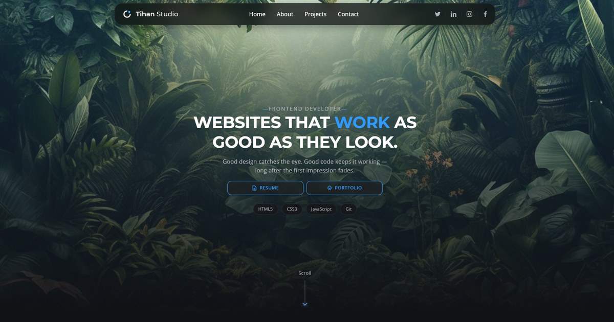

# Tihan Studio – Portfolio

Personal portfolio website of **Danylo Tykhonov**, a junior frontend developer from Kraków.

🔗 **Live demo:** [danieltykhonov.github.io/tihan-studio](https://danieltykhonov.github.io/tihan-studio/)



## About

A dark, editorial-style portfolio built from scratch with plain HTML, CSS and JavaScript – no frameworks or templates.
It presents who I am, my skills, my projects with live demos and a way to contact me.

## Features

- **Responsive layout** – works on screens from 320px up to desktop
- **Mobile menu** – burger button with a full-screen menu, closes on link click and the `Esc` key, locks page scroll while open
- **Projects section** – rendered with JavaScript from a data array, with links to live demos and repositories
- **Smooth scrolling** between sections, with `prefers-reduced-motion` support
- **Retina-ready images** (`@1x` / `@2x`)
- **Accessibility basics** – semantic HTML, `aria-label` / `aria-expanded`, visible focus states
- **Open Graph tags** – a preview card when the link is shared on LinkedIn or in messengers
- **CV in PDF** – available from the Resume button

## Tech stack

- HTML5
- CSS3 (custom properties, Flexbox, Grid, media queries)
- JavaScript (ES6+)
- Git & GitHub Pages

## Project structure

```
tihan-studio/
├── css/
│   ├── main.css          # imports all styles
│   ├── common.css        # variables, base styles, container
│   ├── header.css
│   ├── mobile-menu.css
│   ├── hero.css
│   ├── about.css
│   ├── skills.css
│   ├── project.css
│   ├── contact.css
│   └── footer.css
├── js/
│   ├── project.js        # projects section
│   └── burger-menu.js    # mobile menu
├── img/
├── files/
│   └── cv.pdf
└── index.html
```

## Run locally

1. Clone the repository:
   ```bash
   git clone https://github.com/Danieltykhonov/tihan-studio.git
   ```
2. Open the folder in VS Code.
3. Start it with the **Live Server** extension (or simply open `index.html` in a browser).

## Contact

- LinkedIn: [Danylo Tykhonov](https://www.linkedin.com/in/danylo-tykhonov-b85a0b166/)
- GitHub: [@Danieltykhonov](https://github.com/Danieltykhonov)
